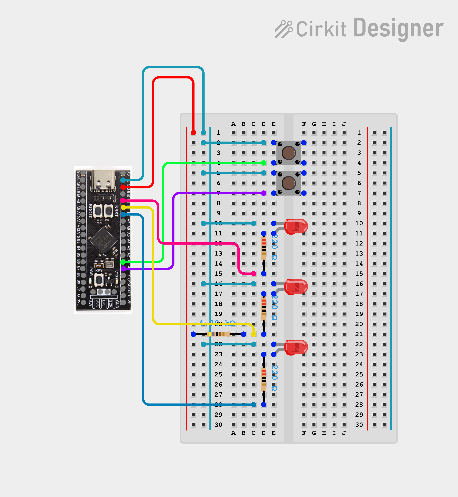

# GPIO Control Panel

Register level GPIO mini project for the STM32F411CEU6 (WeAct Black Pill), no HAL. Two buttons control the behavior of three LEDs across four display modes. Built to exercise MODER, OTYPER, PUPDR, IDR, and ODR together in one working program instead of as isolated register demos.

## Behavior

Pressing the mode button cycles through four modes and wraps back to the start.

1. **Off** — all LEDs off
2. **All on** — all LEDs solid on
3. **Alternating** — LED1 and LED2 blink opposite each other
4. **Chase** — LED3 blinks alone, speed button cycles its blink rate through slow, medium, and fast, wrapping around

Button presses are software debounced using an iteration count, not time based, since there is no SysTick in this subfolder yet. LED timing for alternating and chase modes is also iteration count based for the same reason. All thresholds were tuned by flashing and observing rather than calculated, since there is no precise time reference without SysTick.

## Pin Configuration

| Signal | Pin | Mode | Extra Config |
|---|---|---|---|
| Mode button | PA0 | Input | Internal pull up, active low |
| Speed button | PA1 | Input | Internal pull up, active low |
| LED1 | PB2 | Output | Push pull |
| LED2 | PB1 | Output | Open drain + external pull up resistor |
| LED3 | PB0 | Output | Push pull |

Clocks enabled: `RCC_AHB1ENR` bits for GPIOA and GPIOB.

**LED2 wiring:** anode side through a current limiting resistor to PB1, cathode to GND, same as LED1 and LED3. A separate external pull up resistor also runs from PB1 to the 3.3V rail, since an open drain pin can only pull low or float and cannot drive high on its own.

All components are external on breadboard, nothing onboard used.

## Schematic



Wiring diagram created in Cirkit Designer. See `schematic.png` in this folder for the full breadboard layout, including button wiring, LED orientation, and the LED2 pull up resistor placement.

## Build

```
make clean
make
make flash
```

## Notes

- **Open drain pull up resistor value matters.** A pull up that is too high in value is electrically correct, the pin does reach a valid logic high voltage, but the resulting current is too low for the LED to visibly light. Settled on 470Ω, which is on the low end of typical pull up values but works well here. If reusing this pattern elsewhere, aim for 1kΩ to 10kΩ as a rule of thumb and confirm current draw is enough for the load.
- **LED2 (green) is visibly dimmer than LED1 and LED3.** This is expected, not a fault. The open drain path has two resistors in series (pull up and current limiter) versus one for the push pull LEDs, so less current flows overall. Color dependent forward voltage differences add to this.
- **linker.ld must define `_sidata`, `_sdata`, `_edata`, `_sbss`, `_ebss`.** An older copy pasted version of this project's linker script was missing these symbol definitions, causing undefined reference errors at link time even though startup.s correctly referenced them. Fixed by adding location counter assignments around `.data` and `.bss` in the linker script. Worth checking other project folders copied from the same older template.

